# paceline

A Claude Code status line that paces your usage limits and shows, at a glance, where every session stands.



```
Opus 5.5 · techcentral (dev) · Today: ▕█████░░░░░░░▒▒│ 7/12 · w 59/100 · 4d left · 16m
```

`Today:` is today's budget as a bar that drains as you work: full cells are what's left (past the budget, they turn red and count the overage instead), drained cells what you've spent, and the marker `│` sits at an even share of the week. The numbers after it are weekly percentage points spent of today's budget, so `7/12` and `w 59/100`, your week, add up. The days until the weekly reset follow. Prefer words? The verbose style reads `week 59/100`. Rather count down what's left? Set [`countDirection`](#configuration). The five-hour session segment, `s 16%`, is off by default; turn it on with `"segments": {"session": true}`.

Your weekly limit resets on a fixed schedule, but the status line only tells you how much is left, not whether that's a lot or a little for the days remaining. paceline divides what's left by the days until the reset and gives you **today's budget**, then drains it as you work. A light week gives you a big budget; a heavy one, a small budget. It's most useful on weekends, when you're deciding whether to go hard on side projects or save the rest for Monday.

The rest of the line tells your sessions apart and shows where each one stands: the model and effort, the project in its own color with its git branch, your weekly limit (and your five-hour session, if you turn it on), and warnings when the context window fills up or the prompt cache goes cold.

## Install

paceline is a single binary with no dependencies, for macOS, Linux, and Windows on Intel and ARM.

**Download a release.** Get the archive for your platform from the [latest release](https://github.com/rogadev/paceline/releases/latest), extract `paceline` (`paceline.exe` on Windows), and put it somewhere permanent, such as `~/.local/bin`. Then run:

```sh
paceline install
```

**Or build it with Go** (1.26 or later):

```sh
go install github.com/rogadev/paceline/cmd/paceline@latest
paceline install
```

`paceline install` points Claude Code's `statusLine` in `~/.claude/settings.json` at the binary you ran. It backs up the file first, keeps your other settings and their order, and won't replace a status line you already have unless you pass `--force`. It also asks which label style you want, regular (`w 59/100`) or verbose (`week 59/100`); pass `--regular` or `--verbose` to skip the question. Change the style any time:

```sh
paceline style verbose     # or: paceline style regular
```

To go back:

```sh
paceline uninstall
```

That removes paceline and restores whatever status line it replaced. If you move the binary, run `paceline install` again from the new location.

### Update

Claude Code runs whatever binary is at the installed path, so updating is replacing that file. There's nothing to uninstall or reinstall, and your `paceline.json` config and today's budget carry over.

- **Built with Go:** run `go install github.com/rogadev/paceline/cmd/paceline@latest` again, and `go install github.com/rogadev/paceline/cmd/paceline-mcp@latest` if you use the progress or budget tools.
- **Downloaded a release:** extract the new archive over the old binary.

The next status line refresh uses the new version. Run `paceline --version` to check which one you have. paceline never touches the network, so it can't tell you when a new release is out: watch the [releases page](https://github.com/rogadev/paceline/releases) for that. On Windows, if replacing the file fails because it's in use, try again; paceline only runs for a moment on each refresh.

### Verify a download

Every release archive has a signed build provenance attestation: proof that GitHub Actions built it from this repository. With the [GitHub CLI](https://cli.github.com):

```sh
gh attestation verify paceline_1.1.0_linux_amd64.tar.gz --repo rogadev/paceline
```

`checksums.txt` in each release lists the SHA-256 of every archive.

## What each segment means

| Segment | Example | Shows |
|---|---|---|
| Model | `Opus 5.5` | The model, without the context-size suffix. |
| Effort | `high effort` | Only when effort is above `low` or `medium`. |
| Fast mode | `fast mode` | Only while fast mode is on. |
| Project | `techcentral (dev)` | The folder, in a color unique to the project, and the git branch. |
| Session | `s 82% (resets 3:40pm)` | Off by default; turn it on with `"segments": {"session": true}`. How much of the five-hour limit you've used. The reset time appears once less than 30% is left. Verbose: `session 82% used`. |
| Today | `Today: ▕█████░░░░░░░▒▒│ 7/12` | Today's budget as a bar, then the weekly points you've spent of it. See [today's budget](#todays-budget) below. Both styles read `Today:`. The bar makes a typical line about 120 columns wide; on a narrow pane, hide segments you can spare, such as `"segments": {"branch": false}`, or `"today": false`. |
| Week | `w 59/100` | How much of the weekly limit you've used, in points of 100. Bold from three days before the reset, when a single day's budget can swing. Verbose: `week 59/100`. |
| Days left | `4d left` | Days until the weekly limit resets, or `last day` on the final day. Only when Claude Code reports the reset time. |
| Context | `ctx 72%` | Only when the context window is 70% or more full. |
| Cache | `cache cold: 82k @ ~2x` | Only when the prompt cache has expired. |
| Progress | `loop ▰▰▰▰▱ #44 3/5` | Only while an agent reports a long job's progress. See [Progress bar](#progress-bar). On a narrow pane, hide it with `"segments": {"progress": false}`. |
| Duration | `16m` | Session wall-clock time. Always last, at the right edge. |

**Project colors** come from a hash of the project folder name, mapped to one of 12 evenly spaced hues in the OKLCH color space. Every color is equally bright and easy to read on a dark terminal. Each project keeps its color everywhere, including in subfolders.

### Today's budget

**Today's budget** is the weekly percentage left at the start of the day, divided by the days from midnight to the reset. It stays fixed all day. Whatever you don't spend spreads over the remaining days, so a light week gives you bigger budgets later on.

The bar measures it at one cell per weekly point, against a marker at an even share of the week, 14 points (100 / 7):

- `Today: ▕█████░░░░░░░▒▒│ 7/12` is a 12-point budget with 7 spent. The 5 full cells are what's left and the 7 drained cells what you've spent. The 2 faint red cells are the part of the even share that spending earlier in the week took from today.
- `Today: ▕██████████████│████▏ 0/18 +4 saved` is a budget above the even share. It starts full past the marker, and `+4 saved` is what's left of the surplus. Spending uses the surplus first, so the bar gets shorter: `▕██████████████│██▏ 2/18 +2 saved`, then `▕██████████████│ 4/18`, and from there it drains like any other day.
- `Today: ▕███░░░░░░░░░▒▒│ 15/12 → 11 tmrw` is over budget. The numbers turn red, red cells count the overage from the left (the same `█` as budget left, so without color the numbers are what say you're over), and `→ 11 tmrw` is tomorrow's budget if you spend nothing more today. It's left out once the week has nothing left for tomorrow. The same overspend costs tomorrow more late in the week, when fewer days are left to absorb it.

The numbers' color is your pace advice: green while you have room, yellow once you've used more than 70% of the budget, and red past 85%. A bar longer than 28 cells scales down to fit. On the final day before the reset, the budget is everything left in the week, and there's no tomorrow hint, because the reset brings a fresh week. Instead, `out ~4:40pm` shows in red when the week runs out at today's pace, if that comes before the reset. Today's pace counts from the day's first status line, and the projection waits until that's at least 30 minutes old, since earlier projections swing too much.

Session, week, and today can each count down what's left instead, with [`countDirection`](#configuration). Counting down, `s 18%` means 18% of the session is left, `w 41/100 left` means 41 points of the week are left, and today reads `5/12 left`, or past its budget how far over you are: `3 over/12`. The bar and the colors stay the same either way.

## Progress bar

When an agent works through a long job on its own, such as a batch of issues or a multi-task build, paceline can show how far along it is:

```
loop ▰▰▰▰▱ #44 3/5          one cell per step: done, active, skipped, blocked, pending
orc ▰▰▱▱ #42 review 55%     a planned run: weighted percentage, moving within a step
loop ▰▰▰ review 2/3         a status label the agent set
loop ▰▰▰ ✓ done             finished; hidden 30 minutes later
```

Green cells are done, cyan is the active step, dim is skipped, red is blocked, and hollow cells are still to come. A running job with no update in an hour shows `(paused)`, since whatever was driving it most likely stopped.

Each Claude Code window shows only its own run. Agents in four windows on the same repository get four separate bars, and a new window never shows a run that an earlier session left behind.

The bar comes from a small file in the git directory of the repository you're working in (in a worktree, the worktree's own git directory). paceline only reads it.

- **Agents** write it through the MCP server below, one file per Claude Code session: `.git/paceline/progress-<session id>.json`. Files from sessions that haven't written for a day are cleaned up when a new run starts.
- **Any other program** can write the shared file, `.git/paceline/progress.json`, using the format at the end of this section. Every window in the repository shows it when it has no run of its own, and it's hidden after 4 hours with no update.

### Let agents report progress

`paceline-mcp` is an MCP server that ships in the same release archive as `paceline`. It gives agents five progress tools: `progress_start`, `progress_step`, `progress_label`, `progress_add_steps`, and `progress_finish`. It also gives them two read-only budget tools, described in [Let Claude check your budget](#let-claude-check-your-budget). Register it once for every project:

```sh
claude mcp add --scope user paceline -- /path/to/paceline-mcp
```

If you build with Go, `go install github.com/rogadev/paceline/cmd/paceline-mcp@latest` puts it next to `paceline`.

The tools tell the agent when to use them, so a long job reports progress without extra instructions. To make it a habit, add a line to a skill or to `CLAUDE.md`:

> For work with three or more steps, plan the steps first, then report progress with the paceline progress tools.

**Plan first for an accurate bar.** Without a plan, the bar counts steps, so a big step and a small one move it equally. When the agent starts the run with each step's `weight` (its size relative to the others) and the `stages` it will pass through (for example, `design`, `build`, `review`, `commit`), paceline shows a weighted percentage that also moves as a step advances through its stages.

### Let Claude check your budget

The same server gives Claude two read-only tools for checking your usage, so it can plan around it, for example by checking before a long task or a batch of subagents and choosing a smaller batch when today's budget is nearly spent. You can also ask Claude "how's my budget today?". Both tools need the [usage feed](#usage-feed) on, and the descriptions tell Claude when to call them.

- **`get_usage`**: your five-hour session and weekly limits, each as a percentage used and left, and when each resets, both as a date and time and as clock text such as `Thu 9pm`. A limit the feed has no reading for is reported as missing, not as 0%.
- **`get_today_budget`**: today's budget as the status line's today segment shows it: the budget and what you've spent today, both in percentage points of the week; how much of the budget you've used and have left; whether you're over; and whether today's budget is larger or smaller than an even share of the week. On the last day before the reset, the budget is everything left in the week.

Each answer is a short summary followed by the full set of fields as a JSON object, including how old the reading is in seconds. A reading over 10 minutes old still gets an answer, but the answer starts with its age, for example "This reading is 3h0m old". If paceline has never written the feed file, the tools say so and tell you to run `paceline feed on` rather than failing. After `paceline feed off`, the file stays, so the tools answer from the last reading and lead with its age.

The budget tools never write anything. `get_today_budget` reads the day's starting point that the status line saves, but only the status line updates it.

### Works with orc-pack

[orc-pack](https://github.com/rogadev/orc-pack), an autonomous orchestrator for Claude Code, reports its runs through the progress tools. With `paceline-mcp` registered, an `/orc` run or an `/orc-loop` batch plans its steps and shows up as a bar, such as `orc ▰▰▱▱ #42 review 55%`, with no extra setup.

### Progress file format

Any tool can write this file. Write it through a temp file and a rename, so paceline never reads half of it.

```json
{
  "version": 1,
  "name": "orc",
  "phase": "running",
  "label": "",
  "steps": [
    { "id": "41", "label": "#41", "status": "done", "weight": 3 },
    { "id": "42", "label": "#42", "status": "active", "weight": 5,
      "stages": ["design", "build", "review", "commit"], "stage": "review" },
    { "id": "43", "label": "#43", "status": "pending", "weight": 2 }
  ],
  "updatedAt": "2026-10-06T10:15:00Z"
}
```

| Field | Required | Meaning |
|---|---|---|
| `version` | yes | Always `1`. |
| `name` | yes | Short name shown before the bar, such as `loop` or `orc`. |
| `phase` | yes | `running`, `done`, or `halted`. |
| `label` | no | Replaces the active step's label in the status, such as `review 2/3` or `planning`. |
| `steps` | yes | 1 to 50 steps, in order. Each has a unique `id`, a `label`, and a `status`: `pending`, `active`, `done`, `skipped`, or `blocked`. |
| `steps[].weight` | no | The step's size relative to the others, 0 to 1000. Missing or 0 counts as 1. |
| `steps[].stages`, `steps[].stage` | no | Up to 12 stages the step passes through, and the one it's in now. An active step counts the stages before its current one as finished. |
| `updatedAt` | yes | When the file was last written, as an RFC 3339 time. paceline uses it rather than the file's modified time, so a copied file doesn't look fresh. |

Text fields are at most 40 characters. paceline ignores a file that breaks any of these rules or is larger than 32 KB, and it strips control characters from every label before printing it. The percentage leaves out skipped and blocked steps, since the run won't do them.

## Configuration

Create `~/.claude/paceline.json` (or `$CLAUDE_CONFIG_DIR/paceline.json`) to change the defaults. Every key is optional.

```json
{
  "segments": { "duration": false, "cache": false },
  "thresholds": { "headroomGreen": 30, "headroomYellow": 15, "contextWarn": 70, "contextCritical": 85 },
  "countDirection": { "session": "up", "week": "up", "today": "up" },
  "quietEfforts": ["low", "medium"],
  "projectSlots": { "website": 4 },
  "verbose": false,
  "feed": false
}
```

- `segments`: turn a segment off by setting it to `false`. `session` is off by default, so set it to `true` to show it. The segments are `model`, `effort`, `fastMode`, `project`, `branch`, `session`, `week`, `today`, `context`, `cache`, `duration`, `progress`.
- `thresholds`: percentages where colors change from green to yellow to red, and where the context warning appears. `headroomGreen` and `headroomYellow` count what's left of a limit, so the defaults turn session, week, and today yellow once less than 30% is left (more than 70% used) and red below 15% (more than 85% used), whichever way they count.
- `countDirection`: `"up"` or `"down"` for `session`, `week`, and `today`, each on its own. `"up"`, the default, counts what you've used from 0; `"down"` counts what's left, and shows today past its budget as `3 over/12`.
- `quietEfforts`: effort levels that don't need a label.
- `projectSlots`: pin a project to a color slot from 0 to 11 when two projects you use together get the same color.
- `verbose`: spell out the labels (`week 59/100`, or `session 16% used`) instead of one letter (`w 59/100`, `s 16%`). Today reads `Today:` in both styles. `paceline style` changes it for you.
- `feed`: save your latest usage to a local file other tools can read. Off by default. `paceline feed on` changes it for you; see [Usage feed](#usage-feed).

paceline respects [`NO_COLOR`](https://no-color.org).

## Usage feed

paceline already sees your latest usage every time it draws the status line. Turn on the usage feed and it also saves those numbers to a small file on your computer, so other local tools can read them without asking Anthropic. [paceline-tray](https://github.com/rogadev/paceline-tray) reads it to show your budget in the system tray, and `paceline-mcp` reads it to [answer Claude's questions about your budget](#let-claude-check-your-budget). Nothing leaves your machine.

The feed is off by default. Turn it on or off, or check its state, with:

```sh
paceline feed on      # or: paceline feed off
paceline feed         # shows whether it's on
```

That sets `feed` in `paceline.json` and keeps your other settings. The file is `~/.claude/paceline-feed.json` (or `$CLAUDE_CONFIG_DIR/paceline-feed.json`).

paceline writes it on each status line refresh, through a temp file and a rename, so a reader never sees half of it. When your usage hasn't changed, it rewrites the file at most every 30 seconds. When Claude Code reports no usable usage limits, paceline leaves the file as it is. Turning the feed off stops the updates but doesn't delete the file.

### Feed file format

```json
{
  "version": 1,
  "fiveHour": { "usedPct": 21, "resetsAt": 1790283000 },
  "sevenDay": { "usedPct": 46, "resetsAt": 1790838000 },
  "writtenAt": 1790277013
}
```

| Field | Meaning |
|---|---|
| `version` | Always `1`. |
| `fiveHour` | Your five-hour session limit. Left out when Claude Code didn't report it, or reported a value out of range. |
| `sevenDay` | Your weekly limit. Left out when Claude Code didn't report it, or reported a value out of range. |
| `usedPct` | How much of the limit you've used, from 0 to 100. It can have a fraction. |
| `resetsAt` | When the limit resets, in whole Unix seconds. |
| `writtenAt` | When paceline last wrote the file, in whole Unix seconds. Use it, rather than the file's modified time, to tell how fresh the numbers are. |

The file holds only these fields: no session IDs, paths, or model names. paceline-tray ignores a file over 4 KB, a `version` other than `1`, or a value outside the ranges above.

## Security

paceline runs on every status line refresh, so it's built to do very little:

- No dependencies. It uses only the Go standard library, and a test fails if that changes.
- It never starts processes or touches the network. A test fails the build if the shipped code imports `os/exec`, `net`, `syscall`, `unsafe`, or `plugin`. The git branch is read from `.git/HEAD` directly, so a repo's git config or hooks can't run code when paceline renders.
- It strips control characters, zero-width characters, and bidi overrides from every folder name, branch name, payload field, and progress label before printing, so a hostile repo name can't send escape sequences to your terminal.
- `paceline-mcp` follows the same import rules. Its only effect is writing the progress file in a repository's git directory. The budget tools only read the usage feed, today's budget file, and `paceline.json`.
- The installer never overwrites a settings file it can't parse, and it writes through a temp file so a crash can't truncate your settings.
- Releases are reproducible builds with signed provenance attestations.

See [SECURITY.md](SECURITY.md) to report a vulnerability.

## License

MIT
